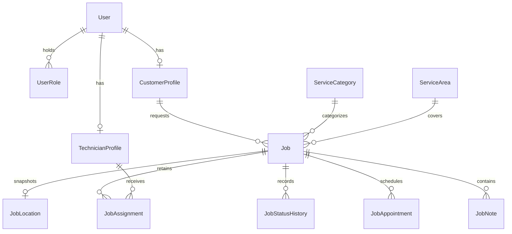

# Database foundation — Phase 4

FallsFix uses PostgreSQL with Prisma ORM 7.10.0 and the PostgreSQL driver adapter. PostgreSQL stores related records and enforces foreign keys and constraints. Prisma generates typed queries from `database/prisma/schema.prisma`; migrations are reviewed SQL files that recreate the structure on another database. The public website still uses editorial categories and does not require a live database.

## Implemented scope

This initial schema covers identity references, catalogue/coverage, and job records. It does not implement authentication, RBAC, assignment endpoints, job transitions, or financial operations. Those operations need server-side permission and business-rule checks in their later phases.

| Model | Purpose and relationships |
| --- | --- |
| User | Canonical lowercase unique email, display/contact information, active/suspended state, timestamps; no passwords or sessions |
| UserRole | Composite user/role membership; a user may hold several explicit roles without duplicate memberships |
| CustomerProfile | Optional one-to-one user extension with business name; one customer has many jobs |
| TechnicianProfile | Optional one-to-one user extension with activation and verification evidence references |
| ServiceArea | Stable area slug, country code, timezone, inactive/active status |
| ServiceCategory | Stable category slug, description, inactive/active status |
| TechnicianSkill / TechnicianServiceArea | Explicit many-to-many eligibility relationships |
| Job | Customer, category and area references; description, preferred instant, status, version and unique submission key |
| JobLocation | One-to-one job address/contact snapshot, separate from mutable profile details |
| JobAssignment | Historical technician assignments, assigning actor, response/end times, outcome/reason |
| JobStatusHistory | Actor and old/new status with time/reason |
| JobNote | Author, text and explicit internal/customer visibility |
| JobAppointment | Job, creator, assessment/work purpose, status, start/end instants |



### Integrity decisions

- UUIDs identify records. A unique numeric job reference supports human lookup but grants no access; later authorization must check ownership even for unguessable IDs.
- A unique request key prepares for submission idempotency. The future service layer must bind/replay keys correctly; a uniqueness constraint alone is not an idempotent API.
- All business references use restricted deletion, preserving history. Deactivation/archival is preferred; data-retention/anonymization policy is still pending.
- Job status, assignment status, appointment purpose/status, role and note visibility are enums. They prevent arbitrary values but do not authorize transitions.
- Timestamps use `timestamptz(3)`; service areas record an IANA timezone. Prisma manages `updatedAt` for Prisma writes; arbitrary SQL does not automatically update that field.
- Indexes support customer job history, operational status queues, technician assignments, and job event timelines.
- Custom SQL in the initial migration adds a partial unique index: only one assignment with `endedAt IS NULL` per job. It also constrains assignment outcome/end-time consistency, nonnegative job versions, appointment ordering, lowercase trimmed emails, nonempty descriptions/notes/addresses, and technician verification/activation consistency. Preserve these SQL additions in future migrations; Prisma's schema language is not their full specification.
- A job can temporarily exist without its `JobLocation` or history at the database level. Phase 8 must create the job, required snapshot, and initial history atomically. Similarly, profile/role alignment, administrator privileges, technician skill/area eligibility, and allowed transitions remain service-layer responsibilities.
- History is not yet protected from direct database edits by an append-only trigger. An application runtime role with narrowly scoped privileges and audited correction operations must be finalized before production.

### Deferred models

Authentication-provider accounts/sessions and role-grant audit records will be designed with the selected provider in Phases 5–6. Uploads, quotes/quote lines, invoices/invoice lines, payment/reversal records, notifications/outbox, reviews, complaints, and configurable financial settings arrive with their respective phases. Do not invent tax, currency, commission, or invoice-issuer rules now. Financial phases must use exact money arithmetic, accepted-price snapshots, immutable issued records, and audited adjustments.

## Local setup on Windows

Prerequisites: the Node/npm baseline in README and PostgreSQL 18 binaries. The development machine has PostgreSQL 18.6 installed at `C:\Program Files\PostgreSQL\18\bin`.

The helper creates an isolated, loopback-only cluster under ignored `.local/postgres`, on port 55433. It does not change the existing Windows PostgreSQL service. It creates `fallsfix_dev`, `fallsfix_shadow`, and `fallsfix_test` databases, plus a non-superuser database-owner role without cluster-level create-role/create-database privileges. Generated credentials are written to ignored `.env`; bootstrap recovery credentials remain in ignored `.local/bootstrap-password.txt`.

From the repository root:

```powershell
npm ci
./database/scripts/start-local-db.ps1
npm run db:generate
npm run db:deploy
npm run db:seed
npm run db:status
```

For another PostgreSQL installation or port, pass `-PostgresBin 'D:\PostgreSQL\18\bin' -Port 55434` on the first helper run. Subsequent runs use the existing cluster configuration and do not replace credentials. The helper refuses to overwrite an existing `.env` or incomplete cluster. If a run fails, inspect the error and `.local/postgres.log`; do not delete/reset a database to make a check pass.

Stop this project-owned cluster when needed:

```powershell
& 'C:\Program Files\PostgreSQL\18\bin\pg_ctl.exe' -D '.local/postgres' -m fast -w stop
```

Restart it with `./database/scripts/start-local-db.ps1`. This is a local development process, not an installed service or production deployment. Do not expose this local cluster to a network. Do not delete `.local/postgres` if you need its data.

## Existing PostgreSQL server or another operating system

Ask your database administrator or use your own local administrative account to create three separate empty databases: `fallsfix_dev`, `fallsfix_shadow`, and `fallsfix_test`, owned by a dedicated non-superuser development role. Create a strong password outside source control. The role does not need `CREATEDB` when a separate shadow database is supplied.

Copy `.env.example` to `.env` and replace every placeholder with the correct URL; percent-encode special characters in URL credentials. Use TLS with verified certificates for remote PostgreSQL. Never set certificate verification to false to bypass connection errors. Then run generation, deployment, seed, and status commands above. Only the migration-development command uses the shadow database; never point it to the application or production database.

## Configuration and commands

| Variable | Used by |
| --- | --- |
| DATABASE_URL | Prisma migration CLI, development seed and lazy application client |
| SHADOW_DATABASE_URL | `prisma migrate dev` scratch database; separate and disposable |
| TEST_DATABASE_URL | Integration tests and their migration preparation; database name must be `fallsfix_test`, distinct from the application DB |

Prisma CLI/scripts load `.env` through dotenv; Next.js loads its standard environment files. Keep database configuration in `.env` for this setup so CLI and application agree. Do not put these credentials in `NEXT_PUBLIC_*`. The template contains placeholders only. Generating types and building the current public pages do not require a live database or connection values.

| Command | Purpose |
| --- | --- |
| `npm run db:generate` | Generate the ignored typed Prisma client |
| `npm run db:validate` | Validate Prisma schema |
| `npm run db:deploy` | Apply checked-in migrations; never create migrations on production |
| `npm run db:migrate -- --name meaningful_change` | Create/apply a new development migration using the separate shadow database |
| `npm run db:status` | Inspect migration application state |
| `npm run db:seed` | Add inactive reference area/categories without overwriting edits; refused with NODE_ENV=production |
| `npm run test:database` | Apply committed migrations to the dedicated test database, then run integration tests |

The seed runs explicitly. Repeating it adds no duplicate categories and does not re-enable or overwrite existing records. It creates no customers, technicians, administrator passwords, jobs, or prices. Its reference category names originate from `frontend/shared/data/services.ts`; the public UI does not yet query these tables.

## Server/client separation

Future Next.js server operations should import `getDatabase()` from `database/client/db.ts`. The `server-only` marker rejects use from a browser component. Lazy singleton creation avoids repeated connection pools during development and avoids touching the database when only public pages are built. The lower-level client factory is for trusted server/CLI code, not public routes. No database object or environment value is passed to client components.

## Tests and verification

`npm run test:database` requires a dedicated `fallsfix_test` database. It applies migrations but never resets or drops the database. Fixtures use transactions that deliberately roll back, including on assertion failure. Tests check reference-seed idempotency and preservation, role uniqueness, snapshot independence, foreign-key/delete protection, request-key uniqueness, current-assignment exclusivity, historical reassignment, appointment ordering, activation checks, rollback atomicity, and application-role privileges. They are database integrity tests, not authentication or RBAC tests.

Run `npm run check`, `npm run build`, and the existing public-site smoke tests to ensure the database addition does not change the website. Re-run the seed and migration deployment to verify repeatability. Record actual results in the phase completion report; do not treat a generated schema as a tested database.

Phase 4 results: schema validation and client generation passed; the migration applied to development and test databases; repeated deployment found no pending migration; repeated seed succeeded. All 12 database tests and four public-site HTTP tests passed, as did lint, strict TypeScript, and production build. Reconstructing the migration in the dedicated shadow database produced no schema difference. The scoped dependency fixes reduced npm audit to zero known vulnerabilities. These results do not verify authentication, RBAC, production deployment, or the outstanding browser interactions.

Additional checks confirmed zero users/jobs and only inactive reference rows in development, no persisted test fixtures, and no database passwords in public build assets. Public homepage/category-preview requests succeeded while the project database was stopped; the helper restarted it successfully. Client generation also succeeded with database variables absent and dotenv loading disabled for that subprocess.

## Production boundary

Phase 5 adds email verification state, library-managed Account/Session/Verification/RateLimit tables, and an atomic credential-customer provisioning trigger in a separate migration. See [authentication](authentication.md) for their responsibilities and additional tests. Historical Phase 4 checks above describe the earlier core-only schema; they do not replace Phase 5 verification.

No hosted database, backup policy, restore drill, production credentials, or deployment is configured. The local owner role is suitable for development migrations, not the final least-privilege production application identity. Separate migration and runtime roles, configure trusted TLS/pooling, establish backup/restore procedures, and review security and authorization before real data collection.

References: [Prisma 7 with Next.js](https://www.prisma.io/docs/guides/v7/frameworks/nextjs), [Prisma configuration](https://www.prisma.io/docs/orm/v7/reference/prisma-config-reference).
