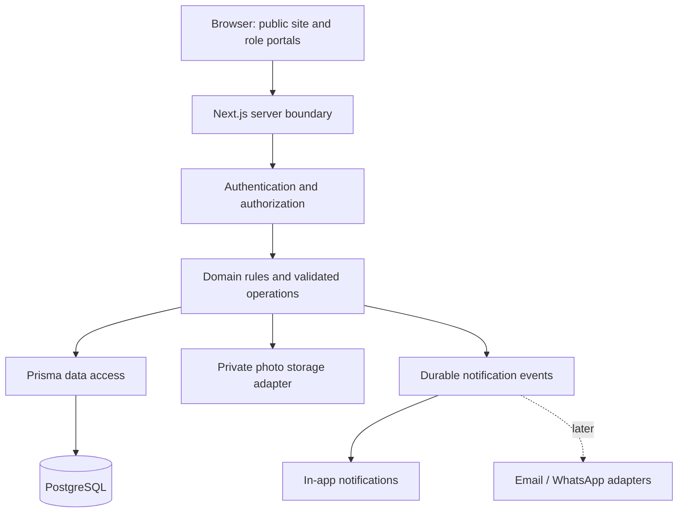

# FallsFix — Phase 0 specification

**Status:** Phase 0 planning deliverable retained as the design baseline. The owner subsequently approved Phases 1–4; see [development setup](development.md), [current architecture](architecture.md), and [database design](database.md). The public prelaunch pages and core database exist; authentication, business APIs, and deployment remain planned. Policies below remain proposals for business validation.

## 1. Business overview

FallsFix will coordinate local maintenance services in Victoria Falls, Zimbabwe. It is a managed service operation: administrators review demand, verify technicians, arrange work, and retain an accountable record from request to settlement. It is not initially an open marketplace where anyone can claim a job.

Potential income consists of disclosed service/call-out fees and configurable technician commissions. Maintenance subscriptions may follow after operations prove reliable. Whether FallsFix or the technician is the contracting supplier and invoice issuer remains a business decision; it must be settled before financial implementation is finalized.

## 2. Problem statement

The working hypothesis is that households and local businesses struggle to find available, trustworthy technicians and to keep track of appointments, prices, progress, and follow-up. Technicians may receive incomplete requests; operators may lose important decisions across calls and messages.

Validate this hypothesis through customer and technician interviews during launch preparation. Do not present assumed demand, customer numbers, response speeds, or revenue as established facts.

## 3. Proposed solution

Provide one place to submit a problem and one traceable job record for coordination. Customers describe their issue and location; administrators match a verified technician; the technician records assessment and progress; the customer accepts the price and confirms the outcome. Invoices, payment records, and reviews complete the record.

The website supports the operational team. It cannot by itself guarantee technician availability, workmanship, emergency response, or collection of payment.

## 4. Target customers

| Segment | Typical need | MVP support |
| --- | --- | --- |
| Households and tenants | Repairs, installation, cleaning | Individual requests with an authorized service contact |
| Landlords and Airbnb hosts | Work at different properties | Multiple service locations under one customer account |
| Lodges and guesthouses | Maintenance with clear scheduling | Individual jobs and invoices, without subscription contracts |
| Shops and offices | Technical support and facilities repairs | Business/contact name on requests and billing details |
| Property managers | Traceable work across properties | Multiple locations; organization teams and delegated access later |

The initial service area is Victoria Falls. Use a service-area reference in the design so expansion does not require rewriting address and eligibility logic; no multi-city administration is needed for MVP.

## 5. Service categories

The candidate catalogue is electrical; plumbing; air conditioning/refrigeration; appliance repair; carpentry; painting; cleaning; gardening; CCTV/security installation; computer/IT support; phone/electronics repair; and general handyman work.

A category groups requests and technician skills. A separately defined service can later represent a specific offering within a category. Administrators should activate only categories with verified operational coverage. Categories must be data, not hard-coded permissions or prices. Archiving a category must preserve past jobs.

## 6. User roles

**Customers** own their requests and financial documents. **Technicians** handle assigned work. **Administrators** coordinate and supervise operations. Visitors browse public information and can apply to become technicians, but an application never grants technician access.

Role-based access control (RBAC) means an operation requires an appropriate role. Ownership checks add a second boundary: being a customer does not permit reading another customer's invoice. Both checks belong on the server, where requests reach the database, regardless of which buttons the interface displays.

| Capability | Visitor | Customer | Technician | Administrator |
| --- | --- | --- | --- | --- |
| Browse public pages/categories | Yes | Yes | Yes | Yes |
| Submit/manage customer request | No | Own | Only with customer role | Manage with audit |
| Read operational job details | No | Own, customer-visible fields | Current assignment, necessary fields | All within operations |
| Assign or verify technicians | No | No | No | Yes |
| Accept assignment/update field progress | No | No | Current assignment | Audited correction only |
| Create/send quotation | No | No | Assessment input only | Yes |
| Approve quotation/confirm completion | No | Own | No | Document dispute resolution, not impersonation |
| Issue invoice/record payment | No | No | No | Yes |
| Submit review | No | Own eligible job | No | Moderate only |
| Manage settings/reports | No | No | No | Yes |

## 7. Functional requirements

Requirement IDs provide stable references for implementation tasks and tests. Phase 3 implements FR-01's public information pages, with request/login/register availability notices. Operational forms and the other business features remain planned. Browser verification of the public pages is still pending.

| ID | Requirement and observable acceptance condition |
| --- | --- |
| FR-01 | Public Home, Services, How It Works, About, Become a Technician, Contact, Request Service, and Login/Register pages; the home page immediately asks “What do you need help with?” and exposes available categories. |
| FR-02 | Established authentication supports customer registration, login/logout, and secure recovery; public input cannot assign privileged roles. |
| FR-03 | Each role can edit permitted profile fields; changing a name/address cannot alter historical job or invoice snapshots. |
| FR-04 | Customers submit a category, description, service address, contact, and preferred time, with optional restricted photos; successful submission creates a reference and REQUESTED history event exactly once. |
| FR-05 | Customers see their active and previous requests, appointments, assigned technician, customer-visible timeline, pending quotes, and invoices; empty accounts show honest empty states. |
| FR-06 | Administrators review requests, manage service categories/customers, verify and activate technicians, and assign/reassign eligible technicians while preserving assignment history. |
| FR-07 | Technicians see today's/upcoming assignments, accept or decline, record assessment, update progress, add notes/photos and a completion summary, and view permitted work history. |
| FR-08 | The server validates actor, ownership, prerequisites, and current state for every transition; rejected operations do not partially update the job or its history. |
| FR-09 | Administrators send itemized versioned quotations; customers approve or reject their current valid quote, and unapproved chargeable work is blocked. |
| FR-10 | Customers confirm completed work or open a complaint; disputes remain visible to administrators and prevent premature closure. |
| FR-11 | Administrators issue invoices from agreed charges and record payments; customers can view and download an invoice representation suitable for printing. Duplicate payment retries cannot double the balance paid. |
| FR-12 | Customers submit one eligible review per job; administrator moderation records its reason without altering the customer's rating. |
| FR-13 | In-app notifications link to authorized records; email and WhatsApp integrations can be added without changing job rules. A notification failure must not undo a valid job operation. |
| FR-14 | Administrator summaries show real job counts, technician workload, collected amounts, and outstanding balances, filtered by period/currency. No seeded demonstration data appears as production analytics. |
| FR-15 | Administrators manage support complaints and configurable business settings; sensitive changes and corrections retain an audit record. |

## 8. Non-functional requirements

These are acceptance targets to verify later, not measured claims.

| Area | Requirement |
| --- | --- |
| Usability | Mobile-first forms with useful labels, field errors, submission feedback, and no dependence on hover. Preserve user input after recoverable errors. |
| Accessibility | Target WCAG 2.2 AA; test keyboard navigation, visible focus, semantic structure, contrast, labels, and screen-reader announcements on critical flows. |
| Responsive layout | Verify critical flows at approximately 360, 768, 1280, and 1920 CSS-pixel widths without horizontal overflow. |
| Performance | Proposed public-page targets: LCP ≤2.5 s, INP ≤200 ms, CLS ≤0.1 at the 75th percentile once field measurement is available. Before launch, measure representative mobile flows and record test conditions; do not claim field results from lab tests. |
| Security | Authenticate protected operations; enforce role and ownership checks on the server; validate input; use provider-managed password/session protection, appropriate CSRF defenses, secure headers, upload controls, and rate limits. |
| Integrity | Use database constraints, transactions, version/concurrency checks, and idempotency for critical writes. Monetary values require exact arithmetic and explicit currency. |
| Reliability | Loading, empty, success, error, forbidden, not-found, and network-failure states must exist. Do not show success before server confirmation or silently retry non-idempotent writes. Offline submission is not an MVP feature. |
| Recovery | Before launch, establish backup schedules and recovery targets, then demonstrate a database restore. Proposed targets for owner review: ≤24 hours data loss and ≤8 hours restoration; these are not current service promises. |
| Privacy | Minimize collected information, redact secrets/personal details in logs, restrict job media, and agree retention/deletion and support-access policies before launch. |
| Maintainability | Strict TypeScript, focused modules, centralized rules/validation, reproducible migrations, meaningful tests, and documentation updated with behavior. |
| Observability | Structured server errors with correlation IDs, audited privileged actions, health monitoring, and an operational incident procedure before launch. |
| Localization | Store instants consistently, display service times in Africa/Harare, and make currency explicit. Do not infer the business timezone from a developer's computer. |

## 9. Business rules

The authoritative proposed policies are in [business-rules.md](business-rules.md). They answer who can assign, decline, cancel, quote, confirm, bill, record payment, review, and close a job.

Implement these in server-side domain functions as features arrive. UI controls explain available actions; they do not define permission. The database adds constraints where possible, and tests verify forbidden as well as permitted behavior.

## 10. Complete customer-to-job-completion workflow

Keep **job progress**, **assignment acceptance**, **quote decisions**, **appointments**, and **financial state** distinct. For example, paying part of an invoice does not change a technician's work status. This avoids an unmanageable collection of combined statuses.

### Main path and job states

| Step | Actor/action | Job state after action | Required evidence/guard |
| --- | --- | --- | --- |
| 1 | Customer submits request | REQUESTED | Valid category, contact, location and description |
| 2 | Administrator reviews | UNDER_REVIEW | Coverage and scope checked |
| 3 | Administrator assigns | TECHNICIAN_ASSIGNED | Active verified eligible technician |
| 4 | Technician accepts | ACCEPTED | Current pending assignment |
| 5 | Technician assesses | ASSESSING | Assessment notes; any visit charge previously accepted |
| 6 | Administrator sends quote if needed | AWAITING_QUOTE_APPROVAL | Immutable priced scope/version |
| 7 | Customer approves quote or accepts defined fixed-price scope | READY_TO_SCHEDULE | Explicit acceptance recorded |
| 8 | Administrator confirms work appointment | SCHEDULED | Availability and customer agreement |
| 9 | Technician travels | ON_THE_WAY | Current assignment and appointment |
| 10 | Technician arrives | ARRIVED | Valid prior work state |
| 11 | Technician starts | IN_PROGRESS | Approved scope/price still applies |
| 12 | Technician submits completion | AWAITING_CUSTOMER_CONFIRMATION | Work summary and required evidence |
| 13 | Customer confirms, or administrator resolves dispute explicitly | COMPLETED | Confirmation/resolution event |
| 14 | Administrator issues invoice | COMPLETED | Agreed charges snapshotted |
| 15 | Administrator records received payment(s) | COMPLETED | Valid method, currency, amount and actor |
| 16 | Customer optionally reviews; administrator closes | CLOSED | Settled/no-charge outcome and no blocking complaint |

An assessment appointment can exist while the job is ACCEPTED or ASSESSING, with separate appointment status and visit notes. The ON_THE_WAY/ARRIVED states above describe the approved work visit. Remote assessment needs no visit. Scheduling the assessment does not imply approval for repair work.

### Exceptions

- Assignment decline: mark assignment DECLINED and return the job to UNDER_REVIEW. Reassignment closes the former assignment and requires the new technician to accept. Once work has begun, reassignment requires administrator coordination and a recorded handover, not a silent reset.
- Quote rejection or expiry: record the quote outcome and return the job to ASSESSING for revised scope or cancellation. Only a new valid acceptance can unlock scheduling.
- New scope during work: pause chargeable work, move to AWAITING_QUOTE_APPROVAL with a recorded reason, and require approval of the new revision. Resume through scheduling; preserve previous progress and all versions.
- Cancellation: enter terminal CANCELLED through the permitted customer/admin operation. Any outstanding disclosed assessment charge or refund is resolved separately; cancellation must not erase financial records.
- Rescheduling before work: replace the appointment with history and return the job to READY_TO_SCHEDULE where appropriate. Do not overwrite the previous appointment record.
- Failed attendance, unsafe conditions, or unavailable parts: record a blocking issue and responsible administrator; arrange a new appointment or scope decision. Do not falsely mark work completed.
- Completion dispute: remain AWAITING_CUSTOMER_CONFIRMATION while the complaint is resolved. Rework can return to IN_PROGRESS through an explicit administrator resolution with a reason and agreed scope.
- Duplicate submission or concurrent updates: reuse the accepted operation result or reject stale state; never produce duplicate assignments/payments or conflicting history.

### Supporting enum concepts

- Assignment: PENDING, ACCEPTED, DECLINED, REPLACED, FINISHED, CANCELLED.
- Quote: DRAFT, SENT, APPROVED, REJECTED, EXPIRED, SUPERSEDED.
- Appointment: PROPOSED, CONFIRMED, COMPLETED, CANCELLED; purpose ASSESSMENT or WORK.
- Invoice: DRAFT, ISSUED, VOID; settlement derived as UNPAID, PARTIALLY_PAID, PAID, with overdue derived from balance and due date.
- Payment record: RECORDED, REVERSED; method CASH, BANK_TRANSFER, MOBILE_MONEY, OTHER with a descriptive reference where appropriate. Gateway-specific states come later.
- Complaint: OPEN, IN_REVIEW, RESOLVED.

These are design enums; Phase 4 will finalize database representation and later workflow phases will implement a tested transition matrix. History and audit records explain exceptional corrections.

## 11. Initial MVP scope

MVP means the smallest end-to-end system the business can operate responsibly, not only a homepage. Deliver it incrementally across the roadmap:

- Victoria Falls service area, a curated active catalogue, and responsive public pages.
- Customer registration/authentication and administrator-provisioned verified technician access.
- Customer requests with location, preferred time, optional photos, history, and support contact.
- Manual administrator review/assignment and technician acceptance/progress/completion.
- Customer-approved quotes, confirmation/disputes, downloadable invoices, and administrator-recorded partial/full payments.
- Basic in-app notifications, reviews, complaint handling, and actual operational totals.
- Server-enforced permissions, secure media access, validation, auditing, backup recovery, and tests of critical flows.

Launch only when this connected workflow is exercised with authorized real participants and the unresolved operating policies are agreed. A completed implementation phase is not automatically a launch-ready business.

## 12. Explicitly excluded from MVP

Online payment gateways; storage of card data; automatic technician payouts; subscriptions; native mobile applications; multi-city operations; automated matching/bidding; live GPS tracking; advanced WhatsApp automation; AI features; predictive analytics; organization teams/delegated access; inventory/payroll/accounting suites; and offline job submission/synchronization.

Automated email delivery can be introduced once a provider and delivery operations are ready, but MVP must not depend on it to persist requests or display their status. No emergency-response promise, automatic refunds, or invented commercial policy is implied.

## 13. System use cases

| Use case | Actor / precondition | Successful outcome | Failure/alternative |
| --- | --- | --- | --- |
| UC-01 Request help | Authenticated customer | Valid request and initial history saved; reference shown | Invalid location/category rejected; retry does not duplicate |
| UC-02 Dispatch technician | Administrator; reviewed request | Eligible technician assigned and notified in-app | Inactive/unverified technician rejected; conflicting assignment prevented |
| UC-03 Accept or decline | Current assigned technician | Acceptance recorded, or request returned to review | Another technician or replaced assignment denied |
| UC-04 Agree price | Administrator sends; owning customer decides | Exact current quote revision approved | Expired/replaced quote cannot be approved; rejection recorded |
| UC-05 Perform work | Accepted current technician; approved scope | Ordered progress events and completion summary | Out-of-order update denied; changed scope requires approval |
| UC-06 Confirm outcome | Owning customer; completion submitted | Confirmation recorded and billing eligible | Complaint holds completion for resolution |
| UC-07 Bill and settle | Administrator; confirmed/resolved work | Invoice issued and balance updated by valid receipts | Duplicate receipt ignored/replayed safely; wrong currency rejected |
| UC-08 Review and close | Owning customer reviews; administrator closes | One review and settled closed record | Review optional; outstanding balance/complaint blocks closure |
| UC-09 Maintain catalogue/access | Administrator | Categories archived safely; technician access audited | Client role escalation and destructive historical changes denied |
| UC-10 Handle support | Customer and administrator | Complaint tracked through documented resolution | Unauthorized access denied; sensitive internal notes withheld |

These use cases become acceptance and integration tests, including attempts to access another user's records.

## 14. Initial system architecture concept

Use a single modular application first. Separate responsibilities in code without introducing independently deployed microservices.



### Technologies and responsibilities

- **TypeScript** checks code shapes during development; it does not validate untrusted input at runtime. **Zod** will perform that runtime validation at server boundaries, with compatible client validation for useful feedback.
- **React and Next.js** provide components, routing, server-rendered pages, and server operations. Protected pages and mutations resolve identity and permissions on the server. Public pages should remain lightweight on mobile connections.
- **Tailwind CSS**, with selective accessible components such as shadcn/ui where useful, supports a consistent interface without imposing a generic dashboard design.
- **PostgreSQL** stores linked records and enforces relational integrity. **Prisma** is the ORM: a typed database access layer between server code and the database. A **migration** is a reviewed, versioned database structure change, applied consistently across environments.
- **Authentication provider/library:** select an established solution after checking the chosen Next.js release and account-recovery/session requirements. Authentication proves identity; FallsFix's authorization layer determines what that identity can do.
- **Private object storage:** store media outside the database; retain ownership, key, type, size, purpose, and timestamps in relational records. Authorize short-lived upload/read access, verify file content and limits, and ensure incomplete uploads cannot become trusted job evidence.
- **Notification adapters:** isolate provider-specific code from job rules. Persist notification intent with the business transaction, then deliver with retries. This durable event/outbox pattern prevents provider downtime from losing a valid request or sending a success notification for a failed transaction.

An **API** is a defined server interface for an operation. Use Next.js server operations for internal forms and REST routes where an external/file interface needs them; do not duplicate every action in both forms. Document each implemented contract's method, route, authentication/roles, input, output, and errors. A shared response pattern should expose safe error codes and field messages without leaking database details.

### Initial relational model

| Group | Candidate records and relationships |
| --- | --- |
| Identity | User with role memberships; optional CustomerProfile and TechnicianProfile; authentication records according to the selected provider |
| Coverage/catalogue | ServiceArea, ServiceCategory, optional Service; technician-to-category eligibility as a many-to-many relation |
| Job operations | Job belongs to customer, category, area, and location snapshot; many assignments, appointments, notes, photos, and status-history records |
| Quoting | Job has quote revisions; each Quote has QuoteItems and a recorded customer decision |
| Billing | Job has Invoice records with InvoiceItems; each invoice has Payment records and explicit reversals/adjustments as policy requires |
| Accountability | Review unique per eligible job/customer; Complaint, AuditEvent, Notification, and durable notification event records |
| Configuration | BusinessSettings stores validated configurable values; agreed financial records snapshot applicable values |

Normalization means separate records for repeated or independently changing information: quote lines do not become dozens of columns on a job. Foreign keys link related records; unique constraints prevent duplicate reviews or operation IDs; indexes speed real lookup patterns such as customer jobs and technician assignments. Phase 4 will decide exact fields, deletion policies, constraints, and indexes rather than guessing a complete schema now.

### Security boundary

Treat all browser data as untrusted. Enforce authentication, role, ownership, validation, and state preconditions before sensitive reads/writes. Use safe ORM access, escape rendered content, avoid arbitrary HTML, protect cookie-authenticated mutations from cross-site requests, and prevent shared caching of private responses. Rate limiting restricts abusive request volume at exposed operations such as login, registration, and uploads. Store secrets in environment configuration, never in source or client bundles.

Business operations that change related records use transactions: all related writes succeed together or none do. Add tests for concurrency, replay, and authorization failures when implementing those operations. Security is part of each phase; Phase 18 is a focused review, not the first security work.

## 15. Development roadmap

Before each phase: explain scope, purpose, technology, files, database impact, and security implications. After implementation: inspect, run applicable checks, verify behavior, update README/docs, state limitations, and propose the next phase.

| Phase | Deliverable | Exit evidence |
| --- | --- | --- |
| 0 | Business/system specification | Required sections and consistency checklist; no application code |
| 1 | Git and development environment | Approved repository setup, ignore rules, documented verified tool versions; no secrets |
| 2 | Next.js foundation | Minimal application with strict types; lint/type checks and production build |
| 3 | Public website | Real responsive content, accessible navigation/forms; visual and interaction checks |
| 4 | PostgreSQL and Prisma | Reviewed schema, migrations, isolated development data, verified setup and constraints |
| 5 | Authentication | Established provider, registration/login/logout/recovery and session tests |
| 6 | RBAC | Server-side role/ownership helpers and direct-access denial tests |
| 7 | Customer portal | Profile and honest empty/read states; ownership tests |
| 8 | Request/job workflow | Persisted requests, core domain transition rules, duplicate/concurrency protections |
| 9 | Admin portal | Review, verification, assignment, catalogue and settings operations with audit |
| 10 | Technician portal | Assigned-job access, acceptance/decline, and valid progress updates |
| 11 | Status/history system | Complete transition coverage and usable timelines; basic history already exists from Phase 8 |
| 12 | Photo uploads | Private access, verified type/size controls, failure handling and authorization tests |
| 13 | Quotations | Versioned pricing and customer approval/rejection; scope gates tested |
| 14 | Invoices/payment records | Exact arithmetic, issuance, download, partial receipts and reversal/retry tests |
| 15 | Notifications | Durable in-app delivery; provider adapters only where configured and tested |
| 16 | Reviews | Eligibility, uniqueness, moderation and complaint/closure behavior |
| 17 | Reports | Stored-data aggregates reconciled against operational records and currency |
| 18 | Security hardening | Threat review, dependency/configuration checks, access/upload abuse testing |
| 19 | Expanded automated testing | Full customer → assignment → work → quote → confirmation → invoice → review flow, including failure paths |
| 20 | Deployment | Reproducible release, migrations, monitoring, backup restore and rollback procedure |
| 21 | Business launch validation | Authorized real-world pilot, agreed policies, support ownership, and launch decision |

Unit tests check isolated domain rules; integration tests check database and component interactions; API tests exercise server contracts and permission denials; end-to-end tests exercise user journeys through the browser. Introduce them as the relevant behavior is built, then expand coverage in Phase 19. Continuous integration (CI) will run repeatable checks on changes once executable code exists; production release automation can follow validated deployment procedures.

## 16. Recommended repository/documentation structure

At the end of Phase 0, only README and the two Phase 0 documents existed. Phase 1 adds repository conventions and development guidance; the README lists the current structure. Add application directories when their responsibility is needed:

```text
app/                 Next.js pages, layouts and server entry points
components/          Shared interface components
lib/                 Domain operations, authorization, validation and adapters
database/prisma/              Schema, migrations and deliberate development seed scripts
public/              Public static assets; never private customer photos
backend/tests/               Tests and fixtures as each feature arrives
docs/                Architecture, database, API, security and deployment guidance
```

Within `lib`, introduce focused modules only as code grows. Later documentation may include `architecture.md`, `database.md`, `authentication.md`, `api.md`, `security.md`, and `deployment.md`. Do not create empty documentation merely to match a template.

Phase 1 should establish `.gitignore`, a descriptive branch/commit workflow, and repository setup instructions. Use `main` plus short-lived feature branches; introduce `develop` only if a real integration/release need justifies it. Do not select a license silently or publish to GitHub without the relevant instruction.

## 17. Initial README structure

The root [README](../README.md) contains the business problem/solution, proposed income sources, user roles, workflow, honest feature status, proposed technology/architecture, conceptual database, actual file structure, current setup status, environment/scripts status, testing/security, API/deployment status, roadmap, contributing, and license decision.

As implementation arrives, replace planning language with tested commands and actual behavior. Add prerequisites, clone/install instructions, environment names, database/migration steps, script descriptions, test commands, deployment instructions, and real screenshots only when they exist. Review documentation whenever a dependency, feature, environment variable, schema, script, or deployment requirement changes.

## Phase 0 completion checklist

- [x] Business overview, problem hypothesis, and proposed solution recorded.
- [x] Target customers and candidate service categories defined.
- [x] User roles, permission boundaries, and ownership requirements described.
- [x] Functional requirements with observable outcomes identified.
- [x] Non-functional targets distinguished from measured guarantees.
- [x] Proposed business rules centralized with stable identifiers.
- [x] Main workflow, exception paths, and separate state concepts documented.
- [x] Initial MVP and explicit exclusions defined.
- [x] Use cases include successful and denied/failure paths.
- [x] Architecture and relational model concepts explained without application code.
- [x] Incremental roadmap includes validation/security throughout.
- [x] Current and future repository structures clearly distinguished.
- [x] Initial README reflects actual implementation status.
- [x] Commercial, operational, privacy, and launch decisions identified for validation.
- [ ] Business owner validates proposed rules, scope, and operating assumptions.
- [x] Business owner approves moving to Phase 1.

Phase 0 ended with documentation only. The owner subsequently approved proceeding to Phase 1. Business-policy validation remains pending; approval to develop does not settle commercial decisions. No Next.js initialization, dependency installation, database setup, or application implementation belongs in Phase 0 or Phase 1.
